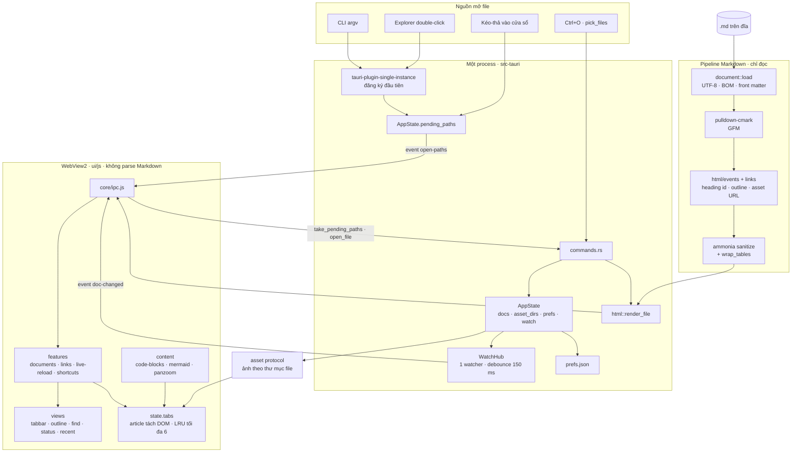
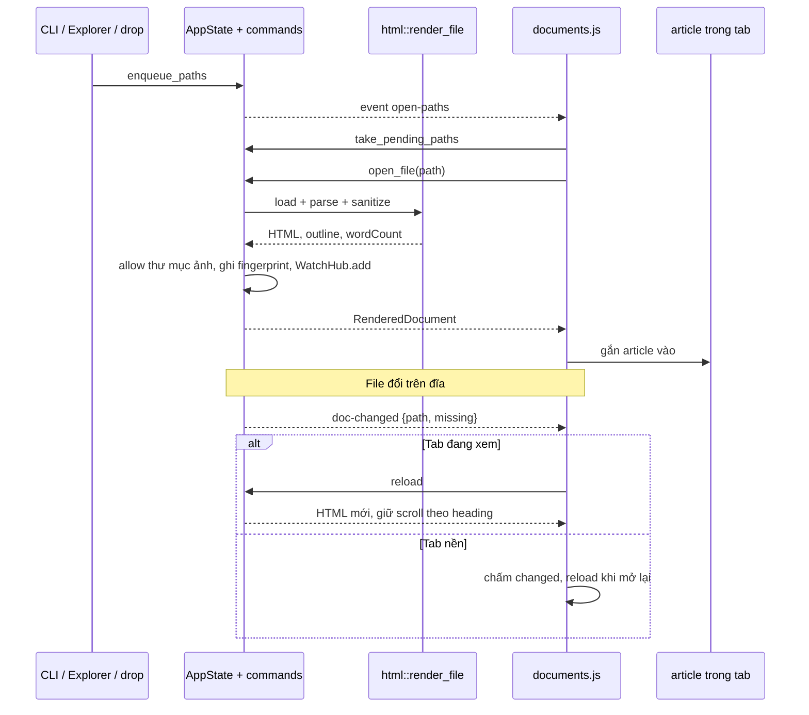

# markdown-look — Notes & Architecture

Last updated: 2026-11-17

## Mục tiêu

Viewer Markdown **read-only**, nhẹ hơn MarkText (không Electron), chạy Windows qua WebView2. Nhiều file trong một cửa sổ (tab), kiểu Notepad: double-click / CLI lần sau gửi vào instance đang chạy.

## Lịch sử quyết định

1. **egui / egui_commonmark** — thử trước; không đạt fidelity MarkText → giữ archive tại `../markdown-look-egui-final/`.
2. **Tauri 2 + WebView2** — chọn cuối cùng: Rust parse Markdown một lần → HTML; UI vanilla trong WebView (không markdown-it, không bundler).
3. **Multi-tab (2026-11-16)** — thay mô hình một file / một process bằng tab + single-instance; ưu tiên hiệu năng (DOM detached, Mermaid lazy + cache SVG).

---

## Kiến trúc

```
markdown-look/                    # Cargo workspace
├── Cargo.toml                    # workspace + release profile (LTO, strip)
├── markdown-512px.png            # nguồn icon app (512×315)
├── NOTES.md                      # file này
├── FEATURES.md                   # danh sách tính năng + phím tắt cho người dùng
├── README.md                     # hướng dẫn chạy nhanh
├── DESIGN.md                     # design system (Station Signage)
├── ui/                           # frontendDist — vanilla HTML/CSS/JS
│   ├── index.html                # titlebar, tabbar, outline, reader, statusbar
│   ├── js/                       # ES modules (entry: type="module" src="js/main.js")
│   │   ├── main.js               # init*() theo thứ tự cũ + boot()
│   │   ├── core/                 # constants, dom, state, ipc (commands + events), paths, lru, icons
│   │   ├── widgets/              # banner, toast, clipboard (chỉ phụ thuộc core)
│   │   ├── content/              # panzoom, mermaid, diagrams, diagram-dialog, code-blocks
│   │   ├── views/                # status, layout, outline, find, recent, tabbar
│   │   └── features/             # documents, reload-queue, live-reload, links, shortcuts, tabbar-input
│   ├── styles/
│   │   ├── fonts.css
│   │   ├── chrome.css            # tokens, titlebar, tabbar, outline, find, status
│   │   ├── article.css
│   │   ├── diagram.css
│   │   └── hljs-theme.css
│   ├── fonts/
│   └── vendor/                   # highlight.min.js, mermaid.min.js
├── tests/fixtures/
└── src-tauri/
    ├── tauri.conf.json           # window, CSP, icons, fileAssociations
    ├── capabilities/default.json
    ├── build.rs
    ├── icons/
    └── src/
        ├── main.rs
        ├── lib.rs                # single-instance (đầu tiên), drop, commands
        ├── cli.rs                # resolve_argv_paths (CLI / second-instance)
        ├── document.rs
        ├── html/                 # pulldown-cmark → rewrite → ammonia
        │   ├── mod.rs            # render_markdown, render_file
        │   ├── links.rs
        │   ├── events.rs
        │   └── sanitize.rs
        ├── commands.rs           # thin wrappers: open / reload / check_changed / close / prefs / pick / asset
        ├── events.rs             # EVENT_DOC_CHANGED, EVENT_OPEN_PATHS, MAIN_WINDOW, APP_NAME
        ├── fingerprint.rs
        ├── paths.rs              # normalize / lexical / parent_dir
        ├── reload.rs
        ├── state.rs              # AppState + DocEntry
        ├── watch.rs              # WatchHub: 1 watcher, nhiều path, debounce 150ms, doc-changed {path, missing}
        └── prefs.rs              # prefs.json
```

Một process Tauri 2: Rust đọc và render Markdown một lần, WebView2 chỉ hiển thị HTML đã lọc. Frontend không có parser Markdown.



Import ở `ui/js` chỉ đi xuống: `core` → `widgets` → `content` → `views` → `features` → `main.js`. Tầng dưới không gọi ngược lên; `main.js` truyền callback khi cần (`initRecent({ open })`, `initDiagrams({ onViewChange })`). State dùng chung nằm trong `state` (`core/state.js`).

### Luồng một file



Ràng buộc không nằm hết trên sơ đồ:

- Asset: chỉ `allow_directory`, không `forbid` (trong Tauri forbid thắng allow — đổi tab sang thư mục khác rồi quay lại sẽ mất ảnh nếu vẫn forbid).
- Fingerprint `(mtime, len)` ghi khi `open_file` / `reload` thành công. `check_changed` chỉ so, không ghi.
- `WatchHub.add` nhận path đã `normalize_path` (`dunce`, bỏ prefix `\\?\`, backslash Windows).
- Notify debounce 150 ms. Ngoài ra poll 2 s chỉ tab đang xem khi cửa sổ hiện; focus hoặc hiện lại thì `check_changed` mọi tab.
- `reload` thử đọc lại sau 100 / 250 / 500 ms. File vẫn mất thì lỗi chứa `"not found"`: giữ article cũ, hiện banner.
- Mỗi tab một `<article>`. Chỉ tab active gắn vào `#preview-scroll`. Tab nền giữ DOM tách; LRU tối đa 6 DOM sống.
- Mermaid: `IntersectionObserver` gần viewport, cache SVG theo theme + source.

### IPC

| Command | Vai trò |
|---------|---------|
| `open_file` | Render path, allow asset dir, WatchHub add, recent; ghi fingerprint |
| `reload` | Render lại theo `path` (giữ `force`). Thử lại 100 / 250 / 500ms; file vẫn mất → lỗi chứa `"not found"`. Thành công thì ghi lại fingerprint |
| `check_changed` | Input `{ paths: string[] }`. Output `[{ path, missing }]` — chỉ file đang mở mà fingerprint đổi hoặc không còn trên đĩa. **Không** ghi fingerprint |
| `close_file` | Giảm refcount; bỏ watch khi về 0 |
| `set_active` | Đặt title cửa sổ (`{title} — markdown-look`) |
| `get_prefs` / `set_prefs` | Đọc/ghi prefs |
| `pick_files` | Dialog chọn nhiều `.md` → `Vec<path>` |
| `take_pending_paths` | Drain path từ CLI / second-instance / drag-drop |
| `resolve_relative` | Resolve link tương đối từ `base` (path tab active) |

**Events**

| Event | Payload | Khi nào |
|-------|---------|---------|
| `open-paths` | (rỗng) | Có path mới trong `pending_paths` — UI gọi `take_pending_paths` |
| `doc-changed` | `{ path, missing }` | WatchHub debounce xong. UI cũng nhận string path cũ (coi `missing: false`). Tab active thì reload; tab nền thì chấm |

### Single-instance (Notepad-style)

- Plugin: `tauri-plugin-single-instance` — **phải đăng ký đầu tiên** trong `lib.rs`.
- Mutex theo `identifier` (`com.markdownlook.viewer`) → mọi build (dev/release/installer) cùng identifier dùng chung một cửa sổ.
- Lần chạy sau: forward argv + cwd → instance đang sống → `enqueue_paths` + focus / unminimize; process thứ hai thoát ngay.
- Cold start: `args_os().skip(1)` → `pending_paths` trước khi UI boot.
- Drag-drop: nhận **toàn bộ** paths (không chỉ file đầu).

**Lưu ý Explorer:** nếu “Open with” trỏ vào exe cũ (trước single-instance), mỗi double-click vẫn mở cửa sổ mới. Cần chọn lại exe mới build, hoặc cài installer (có `fileAssociations`).

### File associations

Trong `tauri.conf.json` → `bundle.fileAssociations`: các đuôi Markdown (`.md`, `.markdown`, …). Chỉ có hiệu lực sau `cargo tauri build` + cài đặt. **Không** đăng ký `.txt` (tránh chiếm Notepad).

### Prefs (config dir app)

`theme`, `zoom`, `outlineOpen`, `sidebarWidth`, `recent` (tối đa 8). **Không** khôi phục session tab khi mở lại app.

### Stack

Tauri 2 · WebView2 · pulldown-cmark · ammonia · notify · tauri-plugin-single-instance · vanilla UI · highlight.js · Mermaid · Be Vietnam Pro · JetBrains Mono

---

## Multi-tab (chi tiết)

### UX

- `#tabbar` nằm trong `#titlebar` (một thanh duy nhất); chỉ hiện khi **≥ 2** tab; 1 file → `#doc-title` ở giữa.
- Tab active: nền surface + hairline + vạch vermilion 2px dưới (One Signal Rule).
- Trùng basename → hiện thêm thư mục cha (faint).
- Đóng: nút × (active/hover), middle-click, Ctrl+W, Delete trên tablist.
- Mở: Ctrl+O / Open / Recent / drop / argv / link `.md` nội bộ (tab mới hoặc focus tab đã mở).
- Phím: Ctrl+Tab / Ctrl+Shift+Tab / Ctrl+PageUp|Down; Ctrl+1–8; Ctrl+9 = tab cuối; Ctrl+Shift+T = mở lại tab vừa đóng (stack 10).

### Frontend model

```
tabs: Map<id, Tab>
  Tab = { id, path, title, el, outline, wordCount, lossyDecode, scrollTop, force, stale, changed, missing }
order: string[]          # thứ tự tab
activeId, lruOrder
MAX_LIVE_TABS = 6        # DOM sống; tab ít dùng → evict el, đánh stale
```

- Chuyển tab: detach article cũ (giữ scrollTop) → attach article mới (hoặc `reload` nếu stale/evicted/missing).
- `changed` → chấm `.tab-changed` trên tab nền; `missing` → banner, article cũ giữ nguyên.
- Module layers (`ui/js`): `core` → `widgets` → `content` → `views` → `features` → `main.js`. Import chỉ đi xuống, không có vòng; khi tầng dưới cần gọi lên thì `main.js` truyền callback (`initRecent({ open })`, `initDiagrams({ onViewChange })`). State dùng chung nằm trong object `state` (`core/state.js`).
- Dedupe path: `samePath()` không phân biệt hoa thường và đổi `\` thành `/`. Không canonicalize lại trong JS.
- Link `.md` nội bộ: `resolve_relative(base=active.path)` → `openPath` (tab mới / focus).

### Backend model

- Frontend sở hữu danh sách tab; Rust giữ `docs` (refcount + force + fingerprint), `asset_dirs` (allow-only), `WatchHub`, `pending_paths`.
- Asset: chỉ `allow_directory`, **không** `forbid` (trong Tauri forbid thắng allow → đổi tab khác thư mục rồi quay lại sẽ mất ảnh nếu vẫn forbid).

### WatchHub

- Một `RecommendedWatcher` + một thread debounce (150ms).
- Refcount theo thư mục (`NonRecursive`); target theo path file đã `normalize_path` (`dunce::canonicalize`, bỏ prefix `\\?\`, backslash trên Windows).
- So khớp event với target: thư mục sau lexical clean + tên file (case-fold, kể cả tiếng Việt). Không `canonicalize` mỗi event (ổn với save kiểu delete+rename). Callback nhận **target đã mở**, không phải path thô từ notify.
- Timeout theo **thay đổi cũ nhất** trong pending (không để file khác trong cùng thư mục hoãn reload mãi).
- `doc-changed` là `{ path, missing }`. `missing` khi target không còn trên đĩa lúc flush.
- Fingerprint `(mtime, len)` nằm trong `docs`, không nằm trong hub. `check_changed` chỉ đọc; ghi lại sau `open_file` / `reload` thành công.

---

## Mermaid (hiệu năng)

Vấn đề: file nhiều diagram → chuyển tab / mở lại bị chậm vì trước đây vẽ tuần tự hết mọi diagram mỗi lần hiện tab.

Giải pháp (2026-11-16):

1. **Lazy theo viewport** — `IntersectionObserver` (`root: #preview-scroll`, `rootMargin: 100% 0px`): chỉ vẽ diagram gần vùng đang đọc; cuộn tới đâu vẽ tới đó.
2. **Không vẽ lại nếu đã có** — mỗi `.diagram` ghi `data-rendered` theo theme; quay lại tab không gọi Mermaid lại.
3. **Cache SVG** — `Map` key = `theme + "\n" + source`, tối đa 80 mục LRU: reload file / evict tab / đổi theme / full window lấy lại SVG đã render.
4. **Hàng đợi một worker** — `diagramQueue` + `drainDiagramQueue`; rời tab giữa chừng → bỏ qua fit; lần sau lấy từ cache.
5. Đổi theme: chỉ `rescheduleVisibleDiagrams()` cho diagram đang gần viewport của tab active.
6. **Nạp script lazy (2026-11-17)** — `mermaid.min.js` (2,6 MB, ~250 ms main thread) không còn là `<script>` trong `index.html`; `loadMermaid()` chèn script khi diagram đầu tiên cần vẽ. File không có diagram không trả chi phí này, và `boot()` không phải chờ nó.

Giữ nguyên UX cũ: theme `base` khớp palette, `securityLevel: "antiscript"`, min scale 68%, full window, Diagram/Source.

## Hiệu năng khác (2026-11-17)

Số đo trong Chromium headless (cùng engine với WebView2):

- **Highlight code lazy** — `enhanceCodeBlocks()` chỉ dựng khung; `hljs.highlightElement` chạy khi block vào vùng `IntersectionObserver` (`rootMargin: 100% 0px`). Block có trong cache (reload) được áp ngay. Block **không** ghi ngôn ngữ để chữ trơn: auto-detect chậm ~6× (20 block × 40 dòng: 187 ms có ngôn ngữ, 1122 ms auto). Find gọi `flushCodeHighlights()` trước khi quét, vì highlight muộn sẽ thay text node và làm hỏng các `Range` đã tìm. `releaseCodeBlocks()` đi cùng `releaseDiagrams()` khi evict / thay / đóng article.
- **Scroll-spy cache** — vị trí heading đo một lần, lưu trong `headingTops`; `ResizeObserver` trên article xoá cache khi kích thước đổi (ảnh, diagram, zoom, bề rộng). Trước đây mỗi frame cuộn gọi 2× `getBoundingClientRect` cho mọi heading (~4 ms/frame ở 1000 heading). Handler `resize` của window gộp qua `requestAnimationFrame`.
- **Thanh tab** — đổi chấm "có thay đổi" chỉ sửa phần tử tab đó (`updateTabChanged`), không dựng lại cả `#tabbar`.
- **Recent** — UI tự cập nhật `state.prefs.recent` cho mọi lần mở (kể cả `openMany` nền) thay vì gọi lại `get_prefs`; tránh `set_prefs` sau đó ghi đè recent của Rust bằng bản cũ. Rust bỏ qua ghi `prefs.json` khi file đã đứng đầu recent.

---

## UI / UX khác đã làm

- Redesign 2026-11-15: Station Signage (`DESIGN.md`). Outline tuyến tàu + status progress.
- Titlebar, outline resize, empty + recent, find, theme, zoom.
- Outline toggle bằng cột grid (tránh `display:none` làm mất bề rộng `#reader`).
- TOC scroll-spy (kể cả cuối trang).
- CSP: `worker-src 'self' blob:` cho Mermaid.
- Titlebar frameless (`decorations: false`): drag region + nút min/max/close trong HTML; không dùng chrome Windows mặc định.

---

## Bảo mật / phạm vi

- Read-only (không sửa file Markdown).
- Asset protocol: allow theo thư mục của từng file đã mở trong phiên (tích lũy, không forbid).
- HTML qua ammonia; script chỉ vendor local.
- Link ngoài → `tauri-plugin-opener`.

CSP (rút gọn): `default-src 'self'`; asset/img; `worker-src 'self' blob:`.

---

## Icon app / taskbar

- Nguồn: `markdown-512px.png` (512×315, không vuông).
- Generate: `cargo tauri icon ./markdown-512px.png --fit contain`
- Đổi icon mà không rebuild → taskbar vẫn icon mặc định Tauri.
- Sau đổi: tắt app rồi `cargo tauri dev` / `cargo build` lại.

---

## Build / chạy

```bash
cd markdown-look
cargo tauri dev
cargo tauri dev -- -- tests/fixtures/huong-dan.md
cargo build -p markdown-look --release
cargo tauri build
```

- Debug: `target/debug/markdown-look.exe`
- Release: `target/release/markdown-look.exe` (+ bundle khi `tauri build`)

> Workspace root là `markdown-look/` — không nhầm với `src-tauri/target/`.

---

## Fixtures / kiểm thử

- `tests/fixtures/sample.md`, `huong-dan.md`, `mermaid-sample.md`
- Unit/smoke Rust (WatchHub, fingerprint `check_changed`, `doc-changed` `{ path, missing }`, reload retry, argv, fixtures)

**Checklist tay (multi-tab + live reload + Mermaid):**

- [ ] Mở 2–3 file trong app (tab hiện từ file thứ 2)
- [ ] Double-click `.md` khi app đang chạy → một cửa sổ, tab mới (cùng exe mới build)
- [ ] Drop nhiều file; mở lại path đã mở → focus tab cũ
- [ ] Sửa file ở tab đang xem (Notepad / Cursor) → toast "Đã cập nhật", giữ scroll
- [ ] Sửa file tab nền → chấm trên tab; mở tab thì reload
- [ ] Xoá file rồi khôi phục: banner, article cũ còn; file trở lại thì reload
- [ ] F5 / Ctrl+R reload tab active, giữ scroll
- [ ] Poll vẫn reload nếu notify không bắn (sửa file khi watcher im, cửa sổ đang hiện)
- [ ] Ảnh ở thư mục khác nhau khi chuyển tab
- [ ] File nhiều Mermaid: chuyển tab tức thì; cuộn mới vẽ dần; quay lại không vẽ lại
- [ ] Đổi theme với nhiều tab; diagram lỗi cú pháp không làm chậm
- [ ] Ctrl+W / Ctrl+Tab / Ctrl+Shift+T; đóng hết → empty state
- [ ] Cửa sổ hẹp < 760px với nhiều tab (cuộn ngang tabbar)

---

## Lệnh icon nhanh

```bash
cargo tauri icon ./markdown-512px.png --fit contain
cargo build -p markdown-look
```
